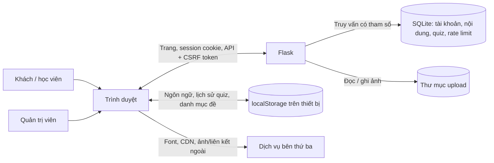

# Bảo mật và quyền riêng tư

## Mục đích và phạm vi

Tài liệu này ghi nhận luồng dữ liệu, ranh giới tin cậy và rủi ro nhìn thấy trong mã nguồn Eduhub. Thời hạn dưới đây mô tả cấu hình/chính sách hiện tại; việc thực thi còn phụ thuộc tác vụ vận hành và nhà cung cấp hosting. Chi tiết vòng đời tài khoản, quiz và backup ở [privacy-data-lifecycle.md](./privacy-data-lifecycle.md).

## Luồng dữ liệu và ranh giới tin cậy

Tin cậy không được mặc định giữa trình duyệt và Flask, giữa Flask và SQLite/upload storage, hoặc giữa Eduhub và bên thứ ba. CSRF token bảo vệ request thay đổi trạng thái dùng session cookie; dữ liệu quiz từ trình duyệt vẫn là đầu vào không đáng tin cậy. `localStorage` nằm ngoài quyền xóa của máy chủ.

## Dữ liệu, mục đích, quyền truy cập và lưu giữ

| Dữ liệu | Mục đích / nơi lưu | Ai truy cập | Hiện trạng lưu giữ |
|---|---|---|---|
| Tên, email, vai trò, password hash | Tài khoản và xác thực; SQLite `users`. Mật khẩu thuần không lưu. | Chủ tài khoản xem/xuất dữ liệu của mình; admin quản lý tài khoản; backend xác thực. | Đến khi tài khoản bị xóa. Người dùng có thể xuất tại `GET /api/auth/me/data` và xóa tại `DELETE /api/auth/me`; lượt quiz liên quan được gộp thành tổng hợp. |
| Session đăng nhập | Cookie Flask có chữ ký, `HttpOnly`, `SameSite=Lax`; chứa `user_id` và trạng thái permanent, không chứa mật khẩu. Chữ ký không mã hóa nội dung. | Trình duyệt gửi cookie; Flask xác thực và phân quyền. | Tối đa 30 ngày. `Secure` tự bật trong `APP_ENV=production`; cần HTTPS ở hosting. |
| Lượt quiz chi tiết | SQLite `quiz_attempts`: đề, môn, điểm, thời lượng, thời điểm và `user_id` nếu đăng nhập; đáp án từng câu không lưu. | Chủ tài khoản xuất lượt của mình; admin đọc báo cáo, các lượt gần đây dùng nhãn “Học viên/Khách”. | Mặc định 365 ngày; lệnh `archive-expired-quiz-attempts` gộp dữ liệu theo tháng/đề rồi xóa lượt chi tiết. Nhà vận hành phải lên lịch chạy lệnh. |
| Tổng hợp quiz theo tháng | SQLite `quiz_monthly_aggregates`, không có user ID, tên, email, thời lượng hay thời điểm từng lượt. | Backend và admin qua thống kê. | Được giữ để duy trì báo cáo; chưa có thời hạn xóa tự động. Cần rà soát định kỳ nguy cơ suy luận ở nhóm dữ liệu nhỏ. |
| Lịch sử quiz, danh mục đề, ngôn ngữ | `localStorage` của thiết bị; lịch sử quiz tối đa 20 lượt. | JavaScript cùng origin trên thiết bị đó. | Đến khi người dùng/trình duyệt xóa; không tự xóa khi xóa tài khoản hoặc dữ liệu server. |
| Ảnh khóa học và ảnh bìa sách | File trong upload storage; đường dẫn nằm trong SQLite. Ảnh giới hạn định dạng, dung lượng và kích thước pixel. | Admin tải lên; file ảnh được phục vụ công khai. | Ảnh bìa sách được xóa khi thay/xóa sách. File ảnh khóa học có thể còn mồ côi sau sửa/xóa; chưa có dọn tự động. |
| Sự kiện giới hạn đăng nhập/đăng ký | SQLite lưu HMAC của IP client và thời điểm, không lưu IP thô trong bảng này. | Backend dùng để giới hạn request xác thực. | Bản ghi cũ được dọn khi có request xác thực; có thể tồn tại lâu hơn cửa sổ giới hạn/24 giờ nếu không có request mới. |
| Request dịch vụ bên ngoài | Trình duyệt tải font/CDN/ảnh hoặc mở video, tài liệu từ URL ngoài. | Nhà cung cấp tương ứng nhận request trực tiếp từ trình duyệt. | Theo chính sách của từng nhà cung cấp; Eduhub không kiểm soát. |

## Kiểm soát hiện có

- Mật khẩu được hash; truy vấn SQLite dùng tham số; endpoint quản trị kiểm tra session và vai trò phía server.
- Request thay đổi trạng thái yêu cầu CSRF token gắn với session; HTML/API cung cấp token qua meta/form/header.
- Production yêu cầu `SECRET_KEY`, không dùng sẵn credential bootstrap; session cookie bật `Secure`. Cookie có `HttpOnly`/`SameSite=Lax`.
- Response áp dụng CSP với nonce cho script, `X-Frame-Options: DENY`, `X-Content-Type-Options` và `Referrer-Policy`.
- Người dùng có endpoint xuất và xóa tài khoản. Quiz có thời hạn cấu hình 365 ngày và cơ chế gộp số liệu trước khi xóa lượt chi tiết.
- Upload ảnh được kiểm tra định dạng, dung lượng và số pixel; rate limit áp dụng cho đăng nhập/đăng ký.

## Rủi ro còn lại và biện pháp giảm thiểu

Mức khả năng xảy ra là đánh giá định tính từ mã nguồn, chưa có log vận hành để xác nhận tần suất.

| Ưu tiên | Kịch bản / tác động | Khả năng | Kiểm soát hiện có / việc cần làm |
|---|---|---|---|
| Cao | Triển khai nhầm `APP_ENV` hoặc dùng credential development có thể khiến cookie không `Secure` hay tài khoản mặc định tồn tại. | Thấp–Trung bình; phụ thuộc cấu hình hosting. | Production yêu cầu secret và bật `Secure`; đặt rõ `APP_ENV=production`, HTTPS, admin riêng và kiểm tra cấu hình trước khi public. |
| Trung bình | Không lập lịch chạy lệnh lưu trữ khiến lượt quiz quá hạn vẫn giữ dữ liệu chi tiết; backup cũ cũng có thể khôi phục dữ liệu đã xóa. | Trung bình; không có scheduler trong ứng dụng. | Lên lịch lệnh ít nhất mỗi ngày, giám sát kết quả, đặt hạn/xóa backup và áp dụng lại yêu cầu xóa sau restore theo [chính sách vòng đời](./privacy-data-lifecycle.md). |
| Trung bình | Client giả mạo điểm hoặc gửi nhiều lượt quiz làm sai lệch báo cáo. | Trung bình; endpoint nhận kết quả công khai. | Server kiểm tra phạm vi và tính phần trăm từ số câu client gửi, nhưng không chấm lại đáp án; chấm tại server và giới hạn gửi nếu báo cáo cần độ tin cậy cao. |
| Trung bình | Request tải font/CDN/ảnh hoặc mở liên kết ngoài làm lộ metadata kết nối cho nhà cung cấp; ảnh khóa học có thể dùng URL ngoài. | Trung bình; phụ thuộc trang và cấu hình trình duyệt. | Duy trì kiểm kê nhà cung cấp, bỏ tài nguyên không cần thiết, thông báo phù hợp và xem lại CSP/referrer policy khi thêm domain. |
| Thấp–Trung bình | Upload ảnh khóa học mồ côi làm tăng lưu trữ; ảnh hiện được phục vụ công khai. | Trung bình khi nội dung thường xuyên sửa/xóa. | Chỉ upload nội dung công khai; bổ sung tác vụ đối chiếu file với bản ghi để dọn file không còn tham chiếu. |
| Thấp–Trung bình | Reverse proxy cấu hình sai làm `request.remote_addr` không phản ánh IP client, giảm hiệu quả rate limit hoặc gom nhiều người dùng vào một giới hạn. | Phụ thuộc hạ tầng. | Chỉ cấu hình proxy tin cậy khi thật sự đứng sau proxy; kiểm chứng IP client và không tin header proxy tùy ý. |

## Issue tiếp theo nên tạo

1. **Vận hành lưu trữ và backup** — cấu hình lịch chạy lệnh quiz hàng ngày, cảnh báo khi lỗi, đặt hạn backup và kiểm thử khôi phục/xử lý yêu cầu xóa.
2. **Tính toàn vẹn quiz** — cân nhắc chấm đáp án ở server và rate limit endpoint nộp bài nếu số liệu cần chống giả mạo.
3. **Dọn upload mồ côi** — kiểm kê file không còn được course tham chiếu và xóa an toàn theo lịch.
4. **Rà soát cấu hình production** — kiểm tra `APP_ENV`, HTTPS, secret, admin, proxy tin cậy và domain bên thứ ba trong từng môi trường triển khai.

Đây là rà soát mã nguồn, không phải kiểm thử xâm nhập, xác nhận môi trường production hay đánh giá pháp lý/chính sách của nhà cung cấp.
